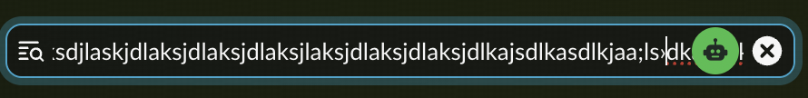
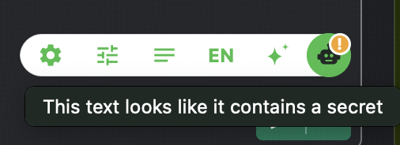
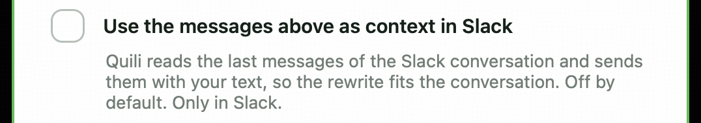
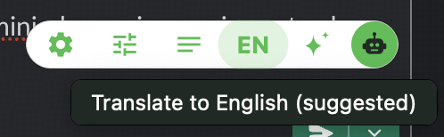
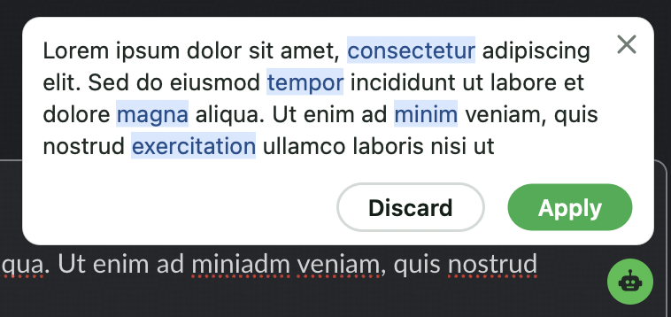
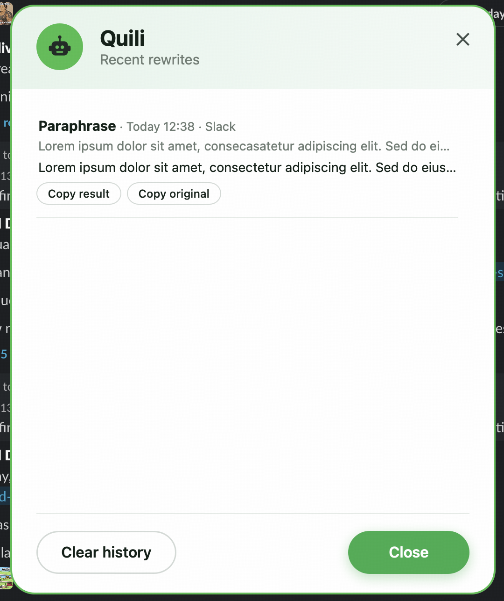
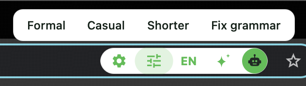
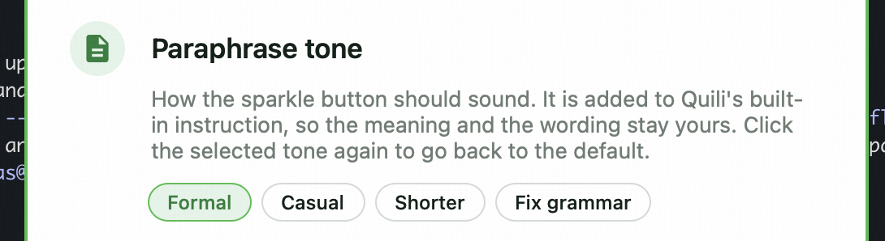
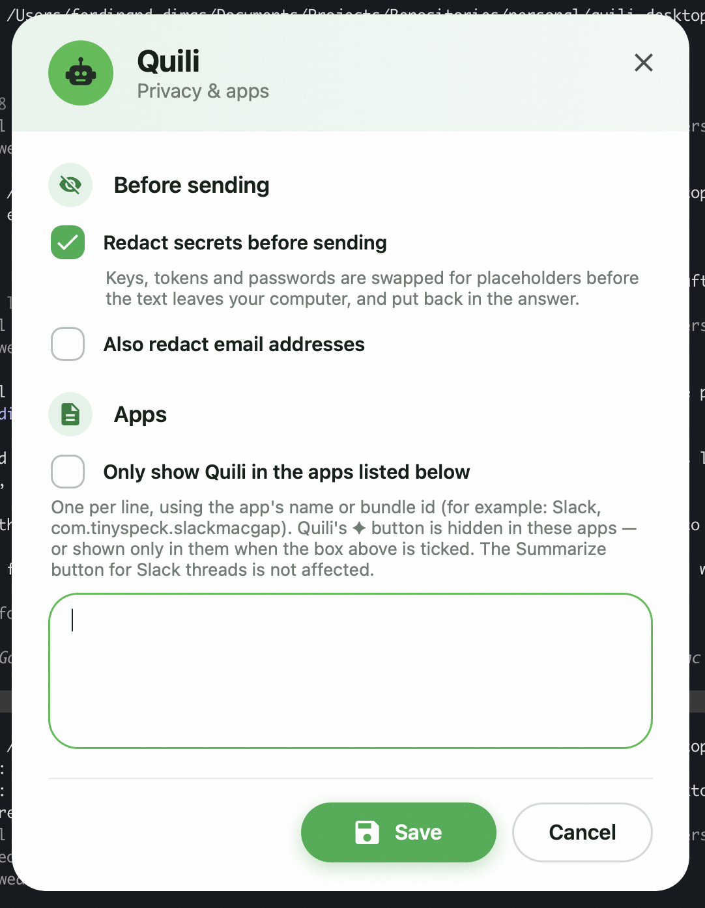

# Changelog

All notable changes to Quili. Versions follow the `VERSION` file; the newest changes are at the top.

## Unreleased

### Fixed
- **The Settings and Privacy & apps windows no longer stay on top of everything (macOS).** They come to the front
  when you open them; after that they behave like normal windows and go behind another app's window when you click
  it. Windows already worked this way.
- **The ✦ button no longer covers the text you type.** When the typing caret reached the button (for example at the
  bottom-right of a text field) the button sat on top of the characters being typed. Quili now follows the caret
  and slides the button to the right of it, with a 5 px gap, and slides it back to its usual place once the caret
  has moved away (after a new line, say). A button you dragged yourself is never moved. macOS and Windows.

  | Before | After |
  | --- | --- |
  |  |  |

### Added
- **Warning before you send a secret.** When the text in the field you are in contains a key, token or password, a
  small orange **!** appears on the Quili button, and its tooltip reads "This text looks like it contains a secret".
  The check runs on your computer and nothing is sent. Turn it off with **Privacy & apps → Warn me when my text
  contains a secret**. macOS and Windows.

  
- **Reply-aware writing (coming soon, switched off).** The groundwork is in: in Slack, Paraphrase and Translate to
  English would read the last messages of the conversation and send them with your text, so the rewrite fits what is
  being discussed (secrets redacted, nothing stored in History, a note in the review bubble). It is not stable yet, so it
  is switched off: **Privacy & apps → Use the messages above as context in Slack** is shown unticked and disabled, with
  a "Coming soon" note, and nothing is read or sent. macOS and Windows.

  
- **The likely next button is highlighted.** If the text in the field does not look like English, a small **EN** tag
  appears on the Quili button and **Translate to English** is highlighted when the pill is open; for a long text
  (800 characters or more) it is **Summarize** instead. The tooltip adds "(suggested)". Worked out on your computer
  from the text alone. macOS and Windows.

  
- **Check setup and Check for updates.** Two new items in the menu-bar (macOS) / tray (Windows) menu. **Check setup…**
  tests the settings, the server and the API key (and, on macOS, the Accessibility permission) and shows a ✓ or ✗ for
  each. **Check for updates…** asks GitHub for the latest release and offers to open it. Quili also checks once a day
  at startup and only speaks up when there is a newer version; **Privacy & apps → Check for updates once a day** turns
  that off. macOS and Windows.
- **Review before replace.** Paraphrase and Translate to English no longer overwrite your text on their own. When the
  AI is done, the bubble shows the result with the words that changed highlighted in soft blue, with **Apply** and
  **Discard** buttons; the text is replaced only when you press Apply (× also discards). If the field changed while
  you were reviewing, nothing is replaced. Undo works as before after Apply. macOS and Windows.

  
- **Recent rewrites.** Hover the ✦ button and click **History** to open a window with your last 10 paraphrases,
  translations and summaries (when, which app, the original and the result), each with **Copy result** and **Copy
  original**. It is stored only on your computer; **Settings → Privacy & apps → Keep my last 10 rewrites** turns it
  off, which also clears it, and the window has a **Clear history** button. macOS and Windows.

  
- **Summarize selected text.** A new **Summarize** button in the pill, and **Summarize selected text** in the menu-bar
  (macOS) / tray (Windows) menu, summarize whatever you selected in any app, not only Slack threads. The pill button
  uses the selection (or the whole field) of the field you are in; the menu item also works on text you cannot type
  in, such as a web page or an email you are reading. The summary appears in a bubble you can close and is copied to
  the clipboard; nothing is written to your text. macOS and Windows.
- **Tone button in the pill.** The pill has a new **Tone** button, right of the Settings gear. Hover it and a small
  bar offers **Formal**, **Casual**, **Shorter** and **Fix grammar**. A click selects that tone, highlights it, and
  paraphrases with it; the ✦ button keeps using it afterwards. The tone is added to Quili's built-in instruction, so
  the meaning and the wording stay yours and only the tone changes. **Settings → Paraphrase tone** has the same four
  chips (click the selected one again to go back to the default). The tone bar and the closable bubbles show the
  normal pointer on macOS. macOS and Windows.

  

  

- **Undo and compare.** After Quili replaces text, an **Undo** / **Original** bar shows for 15 seconds. **Undo**
  puts the text back as it was (only the part Quili replaced, when you had selected a piece of text). **Original**
  shows the text from before in a bubble you can close, so you can compare it with the result. If Quili cannot undo
  automatically, the original is copied to the clipboard. macOS and Windows.
- **Per-app list** (Settings → Privacy & apps). Hide the ✦ button in the apps you list (by name or bundle id on
  macOS, by process name on Windows), or tick **Only show Quili in the apps listed below** to show it only there.
  The Summarize thread button is not affected. macOS and Windows.
- **Redact before sending** (Settings → Privacy & apps). On by default: passwords, API keys, tokens and private keys
  are swapped for placeholders before the text leaves your computer, and put back in the answer; a summary shows
  them as `[hidden value 1]`. If the AI changes a placeholder, nothing is replaced and Quili says why, so a secret
  is never silently lost. Email addresses can be hidden too with **Also redact email addresses**. Applies to
  paraphrase, translate and summarize. The server prompts were updated to keep the placeholders intact. macOS and
  Windows.

  
- **Summarize a Slack thread.** A ✦ button appears beside Slack's own "Summarize thread" button; Quili reads the
  open thread through the accessibility API (no Slack API or token), scrolls through a long thread to read all of
  it, and shows a short briefing: the key discussion, the outcome classified into decisions, action items, open
  questions and risks, and the key details, with the most important points in bold. The bubble scrolls, stays
  until you close it with ×, and the summary is copied to the clipboard.
- **Mock server (offline)** setting: every action (paraphrase, translate, summarize) can run against a built-in
  fixed-answer server when the real one is down.
- **Write debug log** setting to turn logging off.
- Build guide for both platforms and `build.sh` usage in the README.

### Changed
- **The Paraphrase instruction box is gone from Settings.** The base instruction now lives in the app, and you
  choose a tone instead (see the Tone button). An instruction you had typed before is no longer used. macOS and
  Windows.
- Every button of the pill now has its own tooltip: **Settings**, **Tone**, **Translate to English**,
  **Paraphrase** (the green button keeps **Text Tool** / **Cancel**). On macOS they now also show while another app
  is in front. macOS and Windows.
- The Settings and Privacy & apps windows have a green outline, so they are easy to tell apart when both are open.
  macOS and Windows.
- Paraphrase and translate keep the original line breaks and blank lines, and the whitespace around the text,
  so the structure of a message survives being replaced (server side).
- Server-side guards: the text sent to paraphrase, translate and summarize is treated strictly as data and can
  no longer make the model run commands or follow instructions hidden in it.

## 1.0.0
- First release: ✦ button on the focused text field that paraphrases the selected text (or the whole field) in
  place, translates it to natural English, and streams the result into a preview bubble. Windows tray app and macOS
  menu-bar app.
